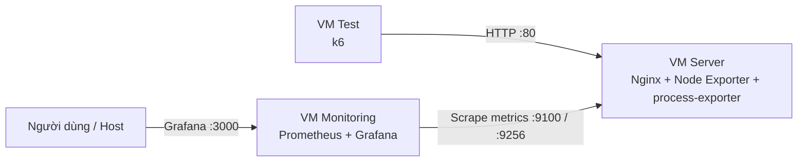

# Server Monitoring & Performance Optimization Lab

> Dự án học tập: thiết kế, triển khai hệ thống giám sát và đánh giá/tối ưu hiệu năng máy chủ trên môi trường VMware.

## 1. Mục tiêu

Xây dựng một môi trường thử nghiệm gồm ba máy ảo Ubuntu, trong đó mỗi máy đảm nhiệm một vai trò riêng:

- **Server:** cung cấp dịch vụ HTTP; xuất metrics hệ thống (Node Exporter) và metrics theo từng tiến trình (process-exporter).
- **Monitoring:** thu thập, lưu trữ và trực quan hóa metrics.
- **Test:** phát sinh tải HTTP và ghi nhận kết quả kiểm thử.

Mục tiêu là tích hợp các thành phần thành một hệ thống có thể triển khai lại, kiểm thử trong cùng điều kiện và sử dụng dữ liệu thu được để phân tích hiệu năng.

## 2. Kiến trúc tổng quan



Luồng hoạt động:

1. k6 trên VM Test gửi HTTP requests đến Nginx trên VM Server.
2. Node Exporter trên VM Server cung cấp metrics hệ thống (CPU, RAM, I/O đĩa, mạng); process-exporter cung cấp metrics CPU/RAM theo từng tiến trình.
3. Prometheus trên VM Monitoring thu thập metrics từ Node Exporter.
4. Grafana truy vấn Prometheus để hiển thị dashboard.
5. Kết quả k6 và metrics hệ thống được đối chiếu để phân tích tải và xác định điểm nghẽn.

## 3. Môi trường triển khai

Các thông số phần cứng đã thống nhất ở mức thiết kế:

| Máy ảo | Vai trò | vCPU | RAM | Disk |
|---|---|---:|---:|---:|
| VM Server | Nginx, Node Exporter, process-exporter | 1 | 1.5 GB | 10 GB |
| VM Monitoring | Prometheus, Grafana | 2 | 2 GB | 10 GB |
| VM Test | k6 | 2 | 1.5 GB | 10 GB |
| **Tổng** | | **5** | **5 GB** | **30 GB** |

- Nền tảng ảo hóa: VMware. 
- Hệ điều hành: Ubuntu Server.
- Mỗi VM có ổ đĩa ảo 10 GB riêng; không chia 10 GB cho cả ba máy.
- Cần ghi lại cấu hình máy Host vì các VM vẫn dùng chung CPU, RAM, ổ đĩa và tài nguyên mạng vật lý của Host.

## 4. Thiết kế mạng

Ba VM sử dụng **một mạng NAT chung** trong VMware Virtual Network Editor, cùng subnet để giao tiếp trực tiếp trong lab.

Thông số IP dưới đây là phương án dự kiến, cần kiểm tra subnet/gateway thực tế trong Virtual Network Editor trước khi cấu hình:

| VM | Hostname dự kiến | IP dự kiến |
|---|---|---|
| Server | `server` | `192.168.100.10/24` |
| Monitoring | `monitoring` | `192.168.100.20/24` |
| Test | `test` | `192.168.100.30/24` |

Gateway ví dụ `192.168.100.2` chỉ sử dụng nếu đúng với cấu hình NAT của VMware. Không tự mặc định gateway hoặc subnet khi chưa kiểm tra.

Chi tiết: [`docs/network.md`](docs/network.md).

### Các luồng/cổng dự kiến

| Nguồn | Đích | Cổng | Mục đích |
|---|---|---:|---|
| VM Test | VM Server | TCP 80 | Gửi HTTP load test đến Nginx |
| VM Monitoring | VM Server | TCP 9100 | Prometheus scrape Node Exporter |
| VM Monitoring | VM Server | TCP 9256 | Prometheus scrape process-exporter (metrics theo tiến trình) |
| Host / máy quản trị | VM Monitoring | TCP 3000 | Truy cập Grafana |
| Host / máy quản trị | Các VM | TCP 22 | SSH quản trị, nếu được bật |

Chỉ mở các cổng cần thiết; cấu hình firewall thực tế sẽ được ghi trong tài liệu triển khai.

## 5. Công nghệ dự kiến

| Thành phần | Vai trò |
|---|---|
| VMware | Tạo và quản lý máy ảo |
| Ubuntu Server | Hệ điều hành cho các VM |
| Nginx | Dịch vụ HTTP được giám sát và kiểm thử |
| Node Exporter | Xuất metrics hệ thống của VM Server |
| process-exporter | Xuất metrics CPU/RAM theo từng tiến trình của VM Server |
| Prometheus | Thu thập và lưu trữ metrics |
| Grafana | Trực quan hóa metrics |
| k6 | Sinh tải và đo hiệu năng HTTP |

Phiên bản phần mềm chưa được coi là chốt cho đến khi được ghi nhận trong tài liệu quản lý phiên bản và các script cài đặt. Không dùng nhãn `latest` làm cơ sở tái lập môi trường.

## 6. Cấu trúc repository

```text
server-monitoring-performance-lab/
├── README.md
├── .gitignore
├── docs/
│   ├── architecture.md
│   ├── environment.md
│   ├── network.md
│   └── deployment-guide.md
├── scripts/
│   ├── common/
│   ├── server/
│   ├── monitoring/
│   └── test/
├── configs/
│   ├── nginx/
│   ├── node-exporter/
│   ├── prometheus/
│   └── grafana/
└── benchmark/
    ├── k6/
    ├── results/
    └── analysis/
```

- `docs/`: thiết kế, thông số môi trường, mạng và hướng dẫn triển khai.
- `scripts/`: script cài đặt/cấu hình theo phần chung và vai trò VM.
- `configs/`: file cấu hình dịch vụ được quản lý bằng Git.
- `benchmark/`: kịch bản tải, dữ liệu kết quả và phân tích.

**Ánh xạ sản phẩm bắt buộc theo phân công:** cột trái là tên sản phẩm trong kế hoạch phân công của nhóm; vị trí thực tế trong repo này là cột giữa. Khi ghi minh chứng vào báo cáo cá nhân và báo cáo chung, dùng đường dẫn ở cột giữa.

| Sản phẩm theo phân công | Vị trí trong repo này | Người chịu trách nhiệm |
|---|---|---|
| `docs/architecture.md` | `docs/architecture.md` | Khang |
| `tests/test-plan.md` | `benchmark/test-plan.md` | Khang |
| `scripts/run-benchmark.sh` | `scripts/test/run-benchmark.sh` | Khang |
| `scripts/analyze-results.py` | `benchmark/analysis/analyze-results.py` | Khang |
| `scripts/setup-server.sh` | `scripts/server/setup-server.sh` | Khôi |
| Bộ cấu hình Nginx / Node Exporter | `configs/nginx/`, `configs/node-exporter/` | Khôi |
| `scripts/setup-monitoring.sh` | `scripts/monitoring/setup-monitoring.sh` | Long |
| `prometheus.yml` + dashboard JSON | `configs/prometheus/`, `configs/grafana/` | Long |

Các thư mục sẽ được bổ sung nội dung khi nhóm triển khai. Không commit file máy ảo dung lượng lớn hoặc thông tin bí mật.

## 7. Bắt đầu triển khai

1. Tạo ba VM theo thông số tại mục 3.
2. Cài cùng phiên bản Ubuntu Server đã được nhóm thống nhất.
3. Tạo một VMnet NAT chung và kết nối cả ba VM vào đúng VMnet đó.
4. Cấu hình hostname, IP, gateway và DNS theo `docs/network.md`.
5. Kiểm tra kết nối giữa các VM bằng `ping` và SSH.
6. Cài dịch vụ theo vai trò; ghi lại phiên bản, lệnh cài, file cấu hình và lệnh xác minh.
7. Hoàn thiện script để thành viên khác có thể dựng lại môi trường.

Hướng dẫn chi tiết sẽ được cập nhật tại [`docs/deployment-guide.md`](docs/deployment-guide.md).

## 8. Quy ước đóng góp

- Mỗi thay đổi nên được thực hiện trên branch riêng và tạo Pull Request vào `dev`.
- Không commit mật khẩu, token, private key, file `.env` chứa bí mật hoặc dữ liệu nhạy cảm.
- Không commit thư mục cài đặt VM, snapshot, `.vmdk` hoặc file máy ảo.
- Script cần có kiểm tra lỗi, ghi rõ phiên bản và có bước xác minh sau cài đặt.
- Kết quả benchmark phải là dữ liệu đo thực tế; không tự tạo số liệu để minh họa như kết quả thật.
- Khi benchmark, ghi lại cấu hình Host/VM, thời điểm chạy, mức tải và điều kiện thử nghiệm.

## 9. Trạng thái dự án

- [x] Thống nhất mô hình ba VM và vai trò từng máy.
- [x] Thống nhất tài nguyên VM ở mức thiết kế.
- [x] Chọn một mạng NAT chung cho ba VM.
- [ ] Chốt phiên bản Ubuntu, subnet, gateway và IP chính thức.
- [ ] Dựng ba VM và kiểm tra kết nối.
- [ ] Cài đặt các dịch vụ theo vai trò.
- [ ] Hoàn thiện script và cấu hình có thể triển khai lại.
- [ ] Thực hiện benchmark, phân tích và tối ưu.

## 10. Tài liệu

- [Kiến trúc hệ thống](docs/architecture.md)
- [Môi trường triển khai](docs/environment.md)
- [Thiết kế mạng](docs/network.md)
- [Hướng dẫn triển khai](docs/deployment-guide.md)
