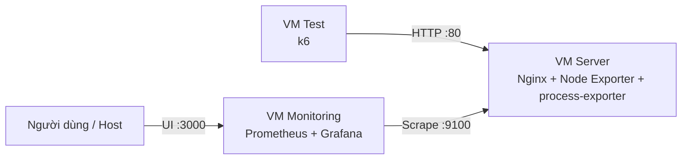

# Kiến trúc hệ thống

## 1. Mục đích

Tách hệ thống thành ba VM theo vai trò để máy chủ được kiểm thử không phải đồng thời gánh phần mềm giám sát và công cụ tạo tải.

## 2. Thành phần

| VM | Vai trò | Thành phần |
|---|---|---|
| Server | Cung cấp dịch vụ và metrics | Nginx, Node Exporter, process-exporter |
| Monitoring | Thu thập và trực quan hóa | Prometheus, Grafana |
| Test | Tạo tải và đo HTTP | k6 |

## 3. Luồng dữ liệu

- VM Test gửi HTTP requests đến Nginx trên VM Server.
- Node Exporter cung cấp metrics hệ thống trên VM Server.
- process-exporter cung cấp metrics CPU/RAM theo từng tiến trình trên VM Server; Prometheus scrape cả hai exporter.
- Prometheus trên VM Monitoring scrape Node Exporter.
- Grafana truy vấn Prometheus để trực quan hóa dữ liệu.
- Dữ liệu k6 được lưu riêng để đối chiếu với metrics hệ thống.

## 4. Sơ đồ

## 5. Lưu ý về tính cô lập

Tách vai trò giữa các VM giúp giảm cạnh tranh tài nguyên trực tiếp bên trong máy Server. Tuy nhiên, ba VM vẫn chia sẻ tài nguyên vật lý của máy Host. Vì vậy cần ghi lại cấu hình Host và theo dõi mức sử dụng tài nguyên Host trong các lần benchmark.
